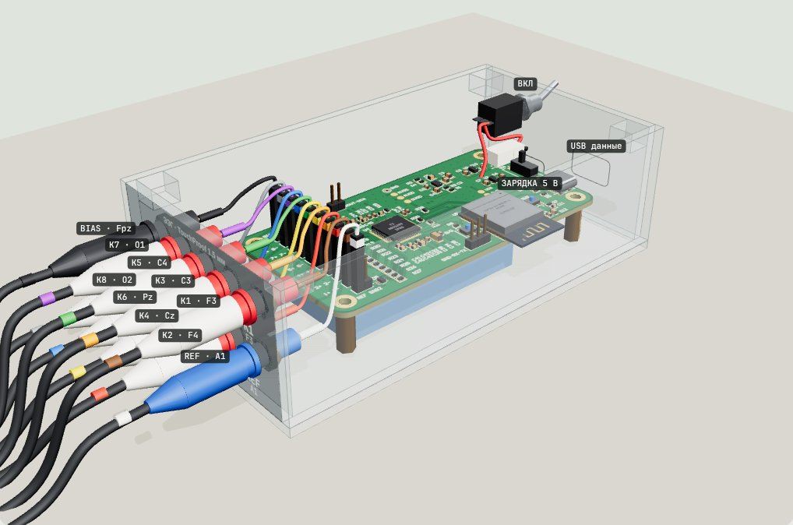

# DIY-EEG-OpenMind: open-source DIY 8-channel EEG (ADS1299 + ESP32-S3)

[Русская версия](README.md) · **[Interactive build guide online](https://paperpit.github.io/DIY-EEG-OpenMind/docs/index.html?lang=en)**

<p align="center"><a href="https://paperpit.github.io/DIY-EEG-OpenMind/docs/04-panel-enclosure-3d.html"></a></p>

An 8-channel EEG (electroencephalography) amplifier you can build at home for neurofeedback and brain-computer interface (BCI) experiments. It is based on the open [Low-Cost-EEG](https://github.com/XavierAsghar/Low-Cost-EEG) board by Xavier Asghar (TI ADS1299 + ESP32-S3, Bluetooth LE). This repository adds what you need to actually reproduce it: 43 step-by-step interactive 3D assembly guides that run in the browser, corrected PCB files, self-test and recording firmware, a browser signal viewer, an acrylic enclosure and a TouchProof electrode panel.

Think of it as a low-cost, OpenBCI-style biosignal board that a hobbyist can solder with a hot plate and a stencil.

> This is a home-made experimental device, not a medical device. Read [SAFETY.md](SAFETY.md) before putting electrodes on anyone. Run it from the battery only while electrodes are attached.

## Specs

- 8 channels, 24-bit ADC (ADS1299), 250 samples/s, REF and BIAS (driven right leg)
- ESP32-S3-WROOM-1-N16R8, Bluetooth LE streaming
- 4-layer PCB, 100 × 50 mm
- LiPo battery with USB-C charging via a TP4056 module
- Acrylic case 137 × 73 × 44 mm cut from one 300 × 200 mm sheet, 10 TouchProof 1.5 mm sockets

## Build route

| Stage | What you do | Where | Time |
|---|---|---|---|
| 0 | Order the PCB and stencil, buy parts | [hardware/](hardware/), [enclosure/](enclosure/) | 1–3 weeks |
| 1 | Read the guides, sort parts, print the checklist | [docs/03-checklist.html](docs/03-checklist.html) | 1 h |
| 2 | Assemble the board: paste, hot plate, bottom side, through-hole parts | [docs/01-assembly-3d.html](docs/01-assembly-3d.html) | 4–6 h |
| 3 | Unpowered checks, first power-up, voltages on TP1–TP6 | [docs/02-tests-3d.html](docs/02-tests-3d.html) | 30 min |
| 4 | Flash the ADS1299 self-test (checks chip ID 0x3E) | [firmware/selftest/](firmware/selftest/) | 1 h |
| 5 | Enclosure, electrode panel, battery and charger | [docs/04-panel-enclosure-3d.html](docs/04-panel-enclosure-3d.html) | 3–4 h |
| 6 | Recording firmware, Bluetooth, see your alpha rhythm (O1/O2, REF on the earlobe) | [firmware/eeg/](firmware/eeg/), [viewer](docs/viewer.html) | 1 h |
| 7 | Optional: second floor with another ADS1299, 16 channels (Russian guide) | [3D lesson](docs/06-16-channels-3d.html), [text](docs/05-16-channels.html), [firmware/eeg16/](firmware/eeg16/) | 1–2 days |

The 3D guides are in Russian for now, but every step is shown on a rotatable model with part highlighting and a part search (type R27, C15, U4), so they are usable without reading the text. The start page and this README are in English.

## Repository contents

```
docs/                       interactive guides (open docs/index.html)
  01-assembly-3d.html         board assembly, 3D
  02-tests-3d.html            post-assembly testing, 3D
  03-checklist.html           printable checklist
  04-panel-enclosure-3d.html  case, electrode panel, power, 3D
  05-16-channels.html         second board on top: 16 channels
  06-16-channels-3d.html      the same in 12 steps in 3D
  viewer.html                 8/16-channel signal viewer over Web Bluetooth (Chrome)
  electrodes/                 electrode reviews: wet Ag/AgCl, MCScap caps, active electrodes
hardware/
  pcb/                        Gerbers + stencil (Rezonit), Gerbers (JLCPCB)
  bom.csv                     bill of materials with corrected values
  INPUT-RESISTORS.md          input resistor noise and safety calculation
  upstream/                   original schematic, layout and author guide (PDF)
enclosure/                  laser-cut DXF, 1:1 drawings, drill template
firmware/selftest/          PlatformIO project: ADS1299 self-test
firmware/eeg/               recording firmware: 250 Hz, Bluetooth LE
firmware/eeg16/             two boards, 16 channels (board_a, board_b)
```

## Changes from upstream Low-Cost-EEG

- Drill files had a (60.4, 50.4) mm offset; fixed in `hardware/pcb/gerber-rezonit.zip`.
- Upstream BOM lists R10–R27 as 100 Ω; they are 2.2 kΩ. R1 = 130 kΩ, R9 = 1 MΩ.
- ESP32-S3-WROOM-1-N16R8 instead of N8R8 (same footprint).
- Added self-test, recording firmware with short BLE packets (works on macOS), browser viewer, enclosure, electrode panel and LiPo power.

The schematic and PCB layout are unchanged.

## License and credits

Board, schematic and original firmware: [Low-Cost-EEG](https://github.com/XavierAsghar/Low-Cost-EEG) by Xavier Asghar, GPL v3. Guides, enclosure, panel, firmware additions and shopping lists in this repository are GPL v3 as well, see [LICENSE](LICENSE) and [NOTICE.md](NOTICE.md).

---

<sub>Keywords: DIY EEG, open-source EEG, open hardware EEG, low-cost EEG, 8-channel EEG, ADS1299, ESP32-S3, EEG amplifier, brain-computer interface, BCI, neurofeedback, biosignal acquisition, OpenBCI alternative, ЭЭГ своими руками, самодельный ЭЭГ, нейроинтерфейс.</sub>
