# DIY-EEG-OpenMind · Народное ЭЭГ

<p align="center"><a href="https://paperpit.github.io/DIY-EEG-OpenMind/docs/index.html"></a></p>

<p align="center"><b>👉 Начинайте изучение здесь: <a href="https://paperpit.github.io/DIY-EEG-OpenMind/docs/index.html">paperpit.github.io/DIY-EEG-OpenMind/docs/index.html</a></b><br>Ничего не нужно скачивать: маршрут сборки и 3D-инструкции открываются прямо в браузере.</p>

Восьмиканальный ЭЭГ для нейрофидбека и экспериментов с BCI, который можно собрать дома. В основе открытая плата [Low-Cost-EEG](https://github.com/XavierAsghar/Low-Cost-EEG) (ADS1299 + ESP32-S3, Bluetooth). Этот репозиторий добавляет к ней всё, чего не хватает для повторения сборки в России: пошаговые 3D-инструкции на русском, файлы для заказа платы в Резоните, списки покупок в Чип и Дипе, на AliExpress и Ozon, прошивку самотеста, корпус из оргстекла и панель для электродов TouchProof.

> Это самодельный прибор для экспериментов, а не медицинское изделие. Прочитайте [SAFETY.md](SAFETY.md) до того, как надевать электроды.

<p align="center"><a href="https://paperpit.github.io/DIY-EEG-OpenMind/docs/index.html">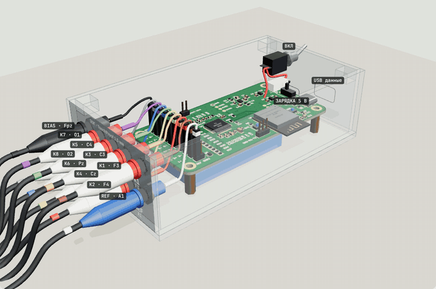</a></p>

## Что получится

| Плата ЭЭГ | Корпус из оргстекла | Панель электродов |
|:---:|:---:|:---:|
| 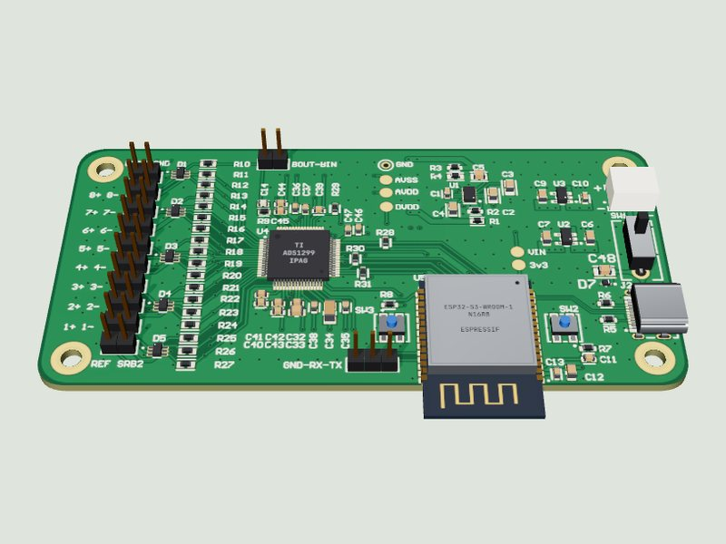 | 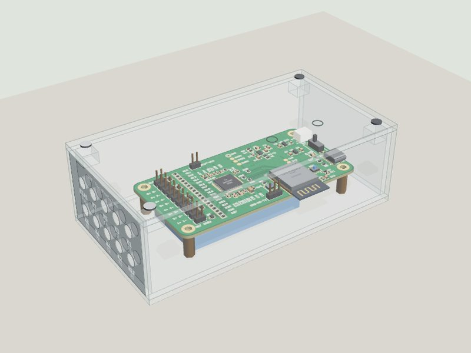 | 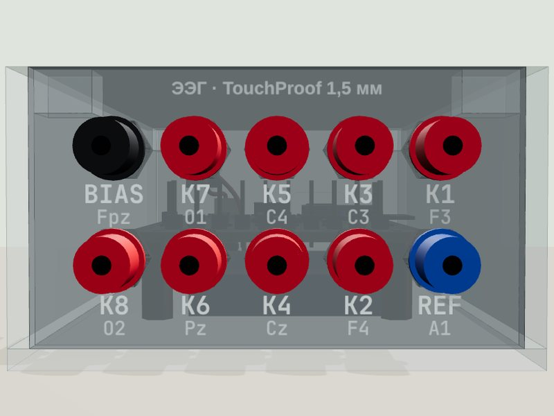 |
| 4 слоя, 100 × 50 мм. ADS1299 снимает 8 каналов, ESP32-S3 передаёт их по Bluetooth | Вырезается из листа 300 × 200 мм, снаружи 137 × 73 × 44 мм | 10 гнёзд TouchProof 1,5 мм: 8 каналов, REF и BIAS |

**Характеристики:** 8 каналов, АЦП 24 бит, 250 отсчётов/с, Bluetooth LE, аккумулятор LiPo с зарядкой по USB-C через TP4056.

## С чего начать

Откройте **[стартовую страницу онлайн](https://paperpit.github.io/DIY-EEG-OpenMind/docs/index.html)**. Чтобы работать без интернета, скачайте репозиторий (**Code → Download ZIP**), распакуйте и откройте **[docs/index.html](docs/index.html)** в Chrome, Edge или Firefox. Это интерактивная стартовая страница: маршрут из 6 этапов с миниатюрами всех 43 шагов и прогрессом, подсказки по интерфейсу и ссылки на все файлы. Все 3D-инструкции работают без интернета, three.js встроен в файлы.

## Маршрут

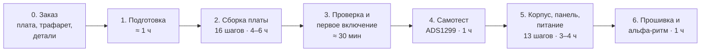

| Этап | Что делаем | Где | Время |
|---|---|---|---|
| 0 | Заказать плату и трафарет, купить детали | [hardware/](hardware/), [enclosure/](enclosure/) | 1–3 недели |
| 1 | Прочитать инструкции, разложить детали, распечатать чек-лист | [docs/03-checklist.html](docs/03-checklist.html) | 1 ч |
| 2 | Собрать плату: паста, столик, нижняя сторона, выводные детали | [docs/01-assembly-3d.html](docs/01-assembly-3d.html) | 4–6 ч |
| 3 | Проверка без питания, первое включение, напряжения на TP1–TP6 | [docs/02-tests-3d.html](docs/02-tests-3d.html), шаги 1–5 | 30 мин |
| 4 | Прошить самотест ADS1299 | [firmware/selftest/](firmware/selftest/), шаги 6–11 части 2 | 1 ч |
| 5 | Корпус из оргстекла, панель электродов, аккумулятор с TP4056 | [docs/04-panel-enclosure-3d.html](docs/04-panel-enclosure-3d.html) | 3–4 ч |
| 6 | Прошивка ЭЭГ, Bluetooth, альфа-ритм: O1 и O2, REF на мочке, BIAS на лбу | [firmware/eeg/](firmware/eeg/), [просмотр](docs/viewer.html) | 1 ч |

### Как это выглядит по ходу сборки

| | | |
|:---:|:---:|:---:|
| 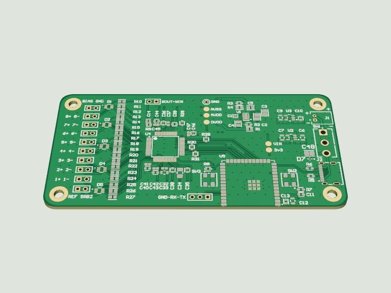<br>**Паста через трафарет** | 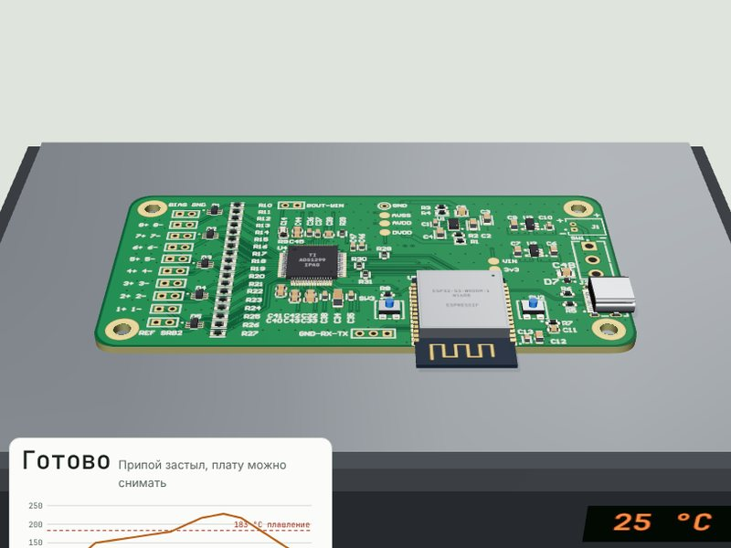<br>**Оплавление на столике с термопрофилем** | 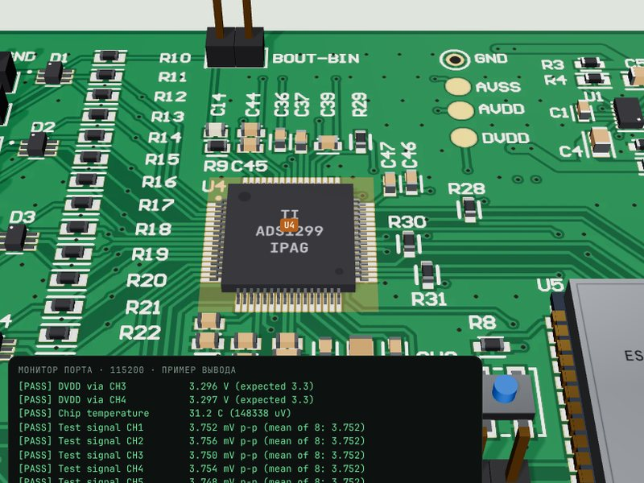<br>**Самотест ADS1299 в мониторе порта** |
| 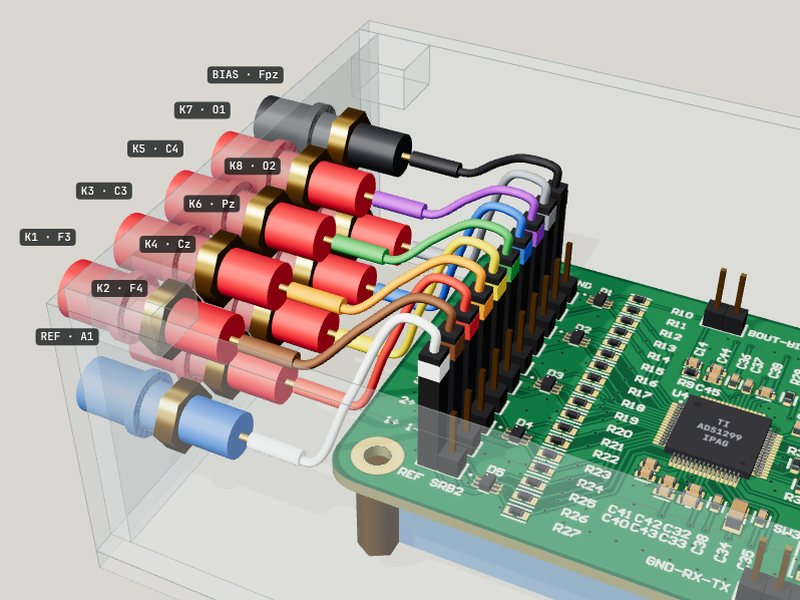<br>**Провода от гнёзд к J3 без перекрещивания** | 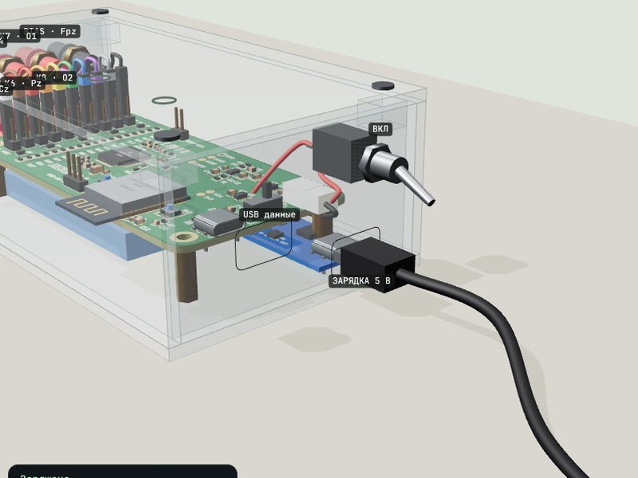<br>**Зарядка через TP4056** | 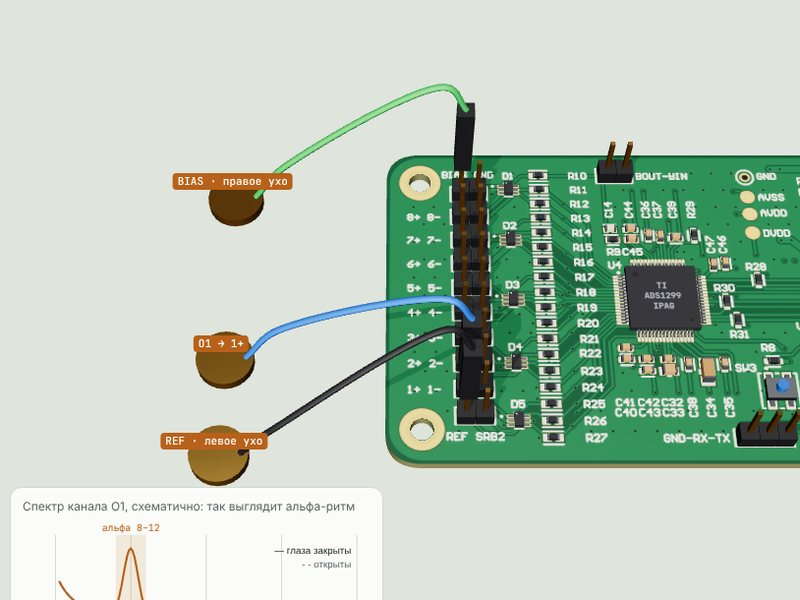<br>**Живой сигнал: альфа-ритм** |

## Как пользоваться 3D-инструкциями

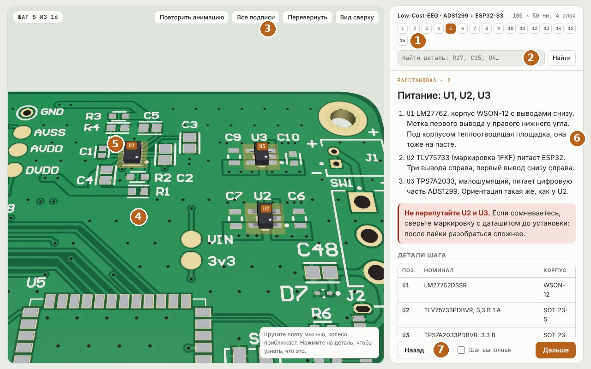

1. **Номера шагов.** Нажмите на любой, чтобы перейти. Можно открыть сразу нужный шаг, добавив к адресу `#5`.
2. **Поиск детали.** Введите R27, C15 или U4, и модель покажет, где она стоит.
3. **Кнопки вида:** повторить анимацию, все подписи, перевернуть плату, вид сверху. В инструкции по корпусу ещё крышка и прозрачность.
4. **3D-сцена.** Левая кнопка мыши вращает, колесо приближает, правая кнопка сдвигает. На телефоне одним и двумя пальцами.
5. **Нажмите на деталь,** чтобы увидеть номинал, корпус и подсказку по установке.
6. **Текст шага:** что делать, предупреждения и таблица деталей.
7. **«Шаг выполнен»** запоминается в браузере, прогресс виден на стартовой странице. Шаги листаются клавишами ← →.

Выбор электродов разобран в [docs/electrodes/](docs/electrodes/01-electrodes-review.html): почему начинать с мокрых, чем хороши MCScap и как устроены активные электроды.

## Что в репозитории

```
docs/                     инструкции
  index.html                стартовая страница: маршрут, прогресс, все шаги
  01-assembly-3d.html       сборка платы, 3D
  02-tests-3d.html          проверка после сборки, 3D
  03-checklist.html         чек-лист для печати, 3 листа A4
  04-panel-enclosure-3d.html  корпус, панель электродов, питание, 3D
  viewer.html               просмотр 8 каналов в Chrome: Mac, Linux, Windows
  electrodes/               обзоры электродов
  img/                      рендеры прибора и миниатюры шагов
hardware/
  pcb/                      Gerber и трафарет для Резонита, Gerber для JLCPCB
  bom.csv                   перечень элементов с исправленными номиналами
  shopping-list.csv         что и где купить, с ценами-ориентирами
  upstream/                 схема и инструкция автора платы (PDF)
enclosure/                  раскрой корпуса DXF, чертежи 1:1, шаблон сверловки, покупки
firmware/selftest/          готовый проект PlatformIO: самотест ADS1299, 16 МБ flash
firmware/eeg/               рабочая прошивка: 500 Гц, Bluetooth, bias на К1 и К2
```

## Что нужно

**Инструменты:** нагревательный столик до 250 °C, паста Sn63/Pb37, флюс, пинцет, лупа, паяльник с тонким жалом, фен, мультиметр, изопропиловый спирт. Лабораторный блок питания желателен.

**Программы:** VS Code с PlatformIO. Сигнал смотрите в Chrome на [странице просмотра](docs/viewer.html). Прошивка уже в [firmware/eeg](firmware/eeg/).

**Бюджет:** ориентиры цен есть в каждом списке покупок. Самая дорогая деталь ADS1299 (3–5 тыс. ₽ на AliExpress). Вся сборка с электродами укладывается примерно в 40 тыс. ₽.

## Отличия от исходного Low-Cost-EEG

- В файлах сверловки автора было смещение (60,4; 50,4) мм, в `hardware/pcb/gerber-rezonit.zip` оно исправлено.
- В BOM автора неверные описания номиналов: R10–R27 = 2,2 кОм, R1 = 130 кОм, R9 = 1 МОм. В `hardware/bom.csv` исправлено.
- Подобраны замены, доступные в России: ESP32-S3-WROOM-1-N16R8 вместо N8R8, TLV75733 как запасной вариант TPS7A2033, проверенные посадки USB-C, SW1, SW2/SW3.
- Нижняя сторона платы двусторонняя (C15–C31, R32–R35, C49, D6). Её паяют феном или паяльником, а не вторым проходом на столике.
- Добавлены самотест, рабочая прошивка с короткими Bluetooth-пакетами для Mac, страница просмотра, корпус, панель электродов TouchProof и питание от LiPo через TP4056 с защитой.

Сама схема и разводка платы не менялись.

## Важные факты о плате

- Кнопки: SW2 = RESET, SW3 = BOOT. SW1 выбирает питание: USB или аккумулятор.
- Контрольные точки: TP1 GND, TP2 AVDD (+2,5 В), TP3 AVSS (−2,5 В), TP4 DVDD (3,3 В), TP5 3V3, TP6 VIN.
- ADS1299 с AliExpress бывают поддельными. Регистр ID настоящего чипа равен 0x3E, самотест это проверяет.
- Входы электродов: штырьки J3A–J3J, электроды только на вывод 1. К1→J3I … К8→J3B, REF→J3J, BIAS→J3A.
- У J1 (аккумулятор) квадратная площадка это минус. Полярность разъёмов китайских аккумуляторов проверяйте мультиметром.

## Статус

Плата заказана и собирается по этим инструкциям. Прошивка самотеста собирается PlatformIO под ESP32-S3-WROOM-1-N16R8 (16 МБ flash). На плате она ещё не запускалась, поэтому эталонного лога монитора порта в репозитории нет: пример удачного вывода есть в части 2 инструкции. Если найдёте ошибку, откройте issue с текстом ошибки или фото.

## Лицензия и авторы

Плата, схема и прошивка: [Low-Cost-EEG](https://github.com/XavierAsghar/Low-Cost-EEG), автор Xavier Asghar, GPL v3.
Инструкции, корпус, панель, самотест и списки покупок этого репозитория распространяются по той же лицензии GPL v3, см. [LICENSE](LICENSE) и [NOTICE.md](NOTICE.md).
